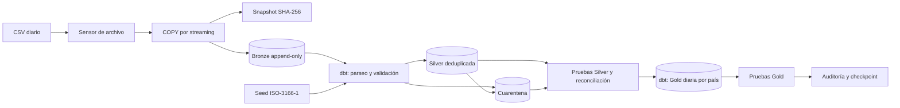

# Arquitectura, contrato y operación

## Arquitectura y orquestación



El [DAG](../dags/daily_sales_medallion.py) tiene esta secuencia:
`wait_for_csv → bronze_ingest → reference_seed → silver_and_quarantine → gold_and_tests → commit_checkpoint`.
El cron corre a las **03:00 UTC**, `catchup=False`, un run activo por vez. Sin
`source_date`, toma la fecha de inicio del intervalo de datos de Airflow, por lo que
el run de las 03:00 procesa el archivo del día anterior. El sensor libera el worker
mientras espera y falla si el archivo no llega en una hora.

Las tareas tienen dos reintentos con espera exponencial, límites de tiempo y callback
de fallo que registra el run, la tarea y el enlace al log. No se configuran envíos a
terceros. Un servicio de alertas puede conectarse al callback cuando se defina con el
Lead. Sólo se pasan identificadores y secuencias pequeñas por XCom; los datos quedan
en el warehouse. No hay conexiones ni consultas a la base al importar el DAG.

| Capa / tabla | Grano y responsabilidad |
|---|---|
| `bronze.transactions_raw` | Una fila física CSV, campos originales como texto, payload JSON y trazabilidad; particiones diarias por fecha **real de ingesta UTC**. |
| `audit.ingestion_batches` | Un lote confirmado por URI de origen + SHA-256; archivo archivado, cantidad de filas, timestamp y secuencia. |
| `staging.stg_transactions` | Una fila por fila Bronze, con tipos seguros y motivos de rechazo. Se retienen las inválidas. |
| `silver.silver_transactions` | Una transacción por `(transaction_id, transaction_at)` normalizado. Es el hecho transaccional. |
| `quarantine.quarantine_transactions` | Una fila por registro inválido o versión desplazada; incluye payload, motivos y referencia al ganador cuando corresponde. |
| `gold.daily_country_sales` | Un hecho agregado por `(business_date UTC, country_code)`, con índice único compuesto. |
| `reference.country_codes` | Dimensión de referencia ISO-3166-1 alpha-2, 249 códigos y nombres; seed generado con pycountry 24.6.1. |
| `audit.pipeline_state` / `pipeline_runs` | Checkpoint exitoso, estado del run, ventanas procesadas, conteos acumulados y errores operativos. |

Gold es un modelo dimensional sencillo: hecho agregado con dimensión país y fecha
como clave natural. La fuente no incluye atributos de cliente ni histórico para
construir una dimensión de clientes/SCD; `customer_id` se conserva en Silver.
Una futura `dim_date` puede aportar calendarios fiscales sin alterar el grano.

## Contrato y reglas de negocio

Las decisiones ante ambigüedades del enunciado están explícitas para revisarlas con
el Lead; la implementación usa estas reglas:

1. **Fechas:** `YYYY-MM-DD`, `YYYY/MM/DD` y timestamps ISO con segundos, fracción
   opcional de hasta 6 dígitos y zona `Z`/`±HH:MM`; sin zona se asume UTC. Se valida
   la fecha del calendario, sin convertir fechas inválidas en fechas distintas.
   Timestamps equivalentes con distintos offsets son la misma clave. Horas distintas
   del mismo día son claves distintas, aunque coincida `transaction_id`.
2. **Importes:** `numeric(18,2)`, punto decimal, hasta dos decimales, coma sólo como
   separador de miles y símbolo inicial opcional `$`, `€` o `£`. `1,234.56` es válido;
   `1,23`, `1.234,56`, exceso de precisión, texto, vacíos y overflow van a cuarentena.
   No se usa `float`, no se adivina el locale ni se redondean valores ambiguos.
   Cero es válido; negativos se rechazan.
3. **Moneda:** se asume que los importes ya están en una **moneda de reporte común**
   y que el símbolo es ruido de formato. La muestra usa símbolos diversos para
   verificar su limpieza. Si representan monedas reales distintas, hacen falta
   `currency_code`, tasas FX y una política de conversión antes de sumar importes.
4. **Calidad:** `transaction_id` y `customer_id` deben tener contenido; se normalizan
   espacios de extremos, país/estado a mayúsculas y se verifica el país contra el
   seed ISO completo. Campos faltantes, estado desconocido, `TEST`, fecha/importe
   inválidos y país inexistente se guardan en cuarentena con todos sus motivos.
5. **Deduplicación:** primero se separan las inválidas. Entre las válidas con la misma
   clave gana `COMPLETED`, después el timestamp de ingesta más reciente. Ante empate:
   secuencia del lote, posición en el CSV y `raw_row_id`, descendentes. Se compara
   contra todo el histórico de esa clave, no sólo contra el archivo actual. Una
   cancelación posterior no desplaza un `COMPLETED`, según la prioridad solicitada.
   Los duplicados desplazados también se auditan en cuarentena.
6. **Estados:** `PENDING` y `CANCELLED` siguen presentes en Silver y participan en el
   denominador del reporte. Sólo `TEST` se excluye por estado. La cancelación se
   atribuye al día de la transacción, porque la fuente no tiene fecha de cancelación.

Cabecera inesperada, archivo vacío, UTF-8 inválido o sintaxis CSV irrecuperable hacen
fallar el lote completo, sin commit parcial. Filas con cantidad incorrecta de columnas
se conservan en Bronze con su payload y terminan en cuarentena. El snapshot original
permite investigar incluso archivos que no pudieron parsearse. `source_line` es el
ordinal del registro de datos (desde 1), también cuando un campo CSV tiene saltos de línea.

Métricas de Gold, sobre **Silver válida y deduplicada**:

| Columna | Cálculo |
|---|---|
| `total_billed_amount` | Suma del importe de `COMPLETED`; 0 si no hay completadas. |
| `average_ticket` | Promedio del importe de `COMPLETED`; NULL si no hay completadas. |
| `unique_transaction_count` | Cantidad de claves compuestas de transacción, incluyendo `PENDING` y `CANCELLED`. No es `count(distinct transaction_id)`. |
| `completed_transaction_count` | Cantidad de completadas, permite recalcular ticket y consolidar países sin promediar promedios. |
| `cancelled_transaction_count` | Cantidad de canceladas. |
| `cancellation_rate_pct` | `100 × canceladas / transacciones únicas procesadas`; precisión de cuatro decimales. |

Los días/países sin transacciones válidas no generan fila. La tasa excluye cuarentena
y duplicados; así la llegada de una copia del archivo no cambia el KPI.

## Idempotencia, incrementales y recuperación

La ingesta crea un snapshot exacto por hash y carga con `COPY FROM STDIN`, sin cargar
el archivo completo en memoria. Datos Bronze y manifiesto del lote hacen commit
juntos. Un lock transaccional serializa ingestas y la asignación de secuencias.
Mismo path y contenido reutiliza el lote; contenido corregido en el mismo path crea
otro lote; misma información desde otro path se resuelve por deduplicación Silver.
Bronze no se actualiza ni se borra desde el pipeline.

Cada ejecución toma la ventana `(último checkpoint exitoso, máximo lote confirmado]`:

- Staging transforma los lotes pendientes con claves de fila inmutables.
- Silver vuelve a rankear **todas las versiones** de las claves afectadas y las
  reemplaza con `delete+insert` transaccional.
- Cuarentena agrega rechazos nuevos y ganadores históricos desplazados. Con reglas
  fijas, un perdedor nunca vuelve a ser ganador: las versiones anteriores permanecen.
- Gold borra y reinserta **días completos afectados**, en una misma transacción por
  modelo. Relee Silver para esos días y elimina grupos obsoletos si un ganador cambia
  de país; resuelve también datos tardíos sin una ventana temporal arbitraria.
- El checkpoint sólo avanza después de que ambos `dbt build` y sus pruebas terminen
  correctamente. Un fallo deja el checkpoint previo y se recupera en el siguiente
  run, aunque éste ingrese otro archivo. Reprocesar un archivo antiguo no retrocede
  el checkpoint.

No hay una transacción única entre todas las capas: Silver puede haber avanzado
mientras Gold sigue en la versión anterior. Cada reemplazo de Gold es atómico, pero
dbt ejecuta sus pruebas **después** del commit del modelo. Si falla una prueba Gold,
no se marca éxito y se reintenta; para publicación estrictamente condicionada a tests
se debe agregar un esquema candidato y un intercambio de vista tras validarlo.
Los consumidores operativos deben verificar `audit.pipeline_runs` para el estado de
la última actualización. Una interrupción del scheduler puede impedir el callback;
los runs `RUNNING` sin actividad requieren monitoreo externo.

Cambios de reglas, corrección manual de modelos o restauración parcial requieren
reconstrucción completa desde Bronze. Con el DAG pausado y sin ejecuciones activas:

```bash
docker compose exec airflow python -m sales_pipeline.run \
  --file /data/incoming/2026-01-01/transactions_raw.csv --full-refresh
```

La CLI reproduce el DAG, registra auditoría y serializa otras CLI mediante un lock
de sesión. **No ejecutar CLI y DAG simultáneamente**: el DAG usa `max_active_runs=1`
y no comparte ese lock entre tareas. Para backfills normales, disparar el mismo DAG
con `source_date`; no se requiere full refresh.

## Escalabilidad y adaptación a nube

Para 500.000 filas diarias, el loader consume memoria acotada y el trabajo de
transformación corre en PostgreSQL. Las particiones Bronze permiten retención por
ingesta; los índices por lote y clave de negocio evitan ordenar todo el histórico
en cada incremental. El costo de Gold depende de los días afectados. Las pruebas de
unicidad y reconciliación completa aún recorren histórico: al crecer, separar controles
incrementales diarios de reconciliaciones completas periódicas y medir planes con
`EXPLAIN ANALYZE`. Este entregable no afirma un SLA de rendimiento sin benchmark.

La réplica staging conserva una fila por raw para auditar y resolver versiones;
requiere planificar almacenamiento, retención y vacuum/analyze. Para crecimiento:
objetos S3/GCS/Azure inmutables con manifiesto de entrega; `COPY` nativo desde storage;
workers distribuidos con el mismo storage; dimensionamiento del warehouse; pools de
Airflow; partición o clustering por fechas y claves; métricas de frescura, volumen,
latencia y rechazos por motivo. Separar credenciales/roles para ingesta, dbt y BI,
retirar permisos de UPDATE/DELETE sobre Bronze al rol de ingesta, inyectar secretos
desde un backend y limitar acceso/retención de datos de cliente en cuarentena.

**Backend implementado y probado: PostgreSQL 16.** No se presenta compatibilidad
Snowflake sin probar. El modelo relacional, ranking y métricas usan SQL común; el
parseo seguro (`pg_input_is_valid`), `timestamptz`, JSONB, índices, particiones,
locks y `COPY` son específicos de PostgreSQL. Para Snowflake: adapter/perfil propio,
`TRY_TO_TIMESTAMP_TZ`/`TRY_TO_DECIMAL` con formatos explícitos, Bronze en stage +
`COPY INTO`, metadata del archivo y clustering apropiado; reemplazo transaccional
de los días Gold y `merge`/`delete+insert` Silver. La política de deduplicación y las
pruebas de reconciliación se conservan, pero deben validarse en ese backend.

## Preguntas para el Data Engineering Lead

- ¿Todos los importes ya están convertidos a la misma moneda? ¿Qué formatos/locale
  y política FX deben aceptarse?
- ¿El día de negocio es UTC o una zona por país? ¿La clave usa el instante completo
  o sólo la fecha de calendario?
- ¿Una cancelación posterior puede anular una venta completada, pese a la prioridad
  de `COMPLETED` del enunciado? ¿Hay reembolsos en otra fuente?
- ¿Ticket promedio sólo sobre ventas completadas y denominador de cancelación sobre
  transacciones válidas deduplicadas, como aquí, o se necesita otro KPI?
- ¿Hora límite, señal de archivo completo, días legítimamente vacíos, SLA, tolerancia
  de rechazos, retención y política de publicación después de tests?
- ¿Destino definitivo PostgreSQL o Snowflake, storage cloud, esquema de permisos,
  canal de alertas y horizonte de crecimiento/latencia esperados?

Estas respuestas no se simulan; las decisiones vigentes quedan arriba para que el
pipeline sea reproducible mientras se aclaran.

Referencias: [Airflow standalone](https://airflow.apache.org/docs/apache-airflow/2.10.5/start.html),
[incrementales dbt](https://docs.getdbt.com/docs/build/incremental-models),
[configuración PostgreSQL dbt](https://docs.getdbt.com/reference/resource-configs/postgres-configs),
[validación de entradas PostgreSQL 16](https://www.postgresql.org/docs/16/functions-info.html#FUNCTIONS-INFO-VALIDITY).
